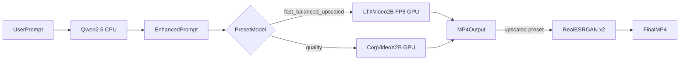

# t2v-generator

**Local text-to-video generation for low-VRAM GPUs**

[](https://www.python.org/downloads/)
[](https://pytorch.org/)
[](https://fastapi.tiangolo.com/)
[](https://gradio.app/)
[](LICENSE)

Run **text-to-video** inference entirely on your machine — no cloud API required. This project combines **Qwen2.5**, **LTX-Video**, **CogVideoX**, and **Real-ESRGAN** into a single ensemble pipeline optimized for **6 GB VRAM** GPUs (e.g. RTX 4050 laptops).

> **Keywords:** text-to-video, local AI, low VRAM, LTX-Video, CogVideoX, Qwen, Real-ESRGAN, diffusers, FastAPI, Gradio

---

## Table of Contents

- [Features](#features)
- [Architecture](#architecture)
- [Requirements](#requirements)
- [Quick Start](#quick-start)
- [Presets](#presets)
- [Usage](#usage)
  - [Gradio Web UI](#gradio-web-ui)
  - [REST API](#rest-api)
- [Configuration](#configuration)
- [Project Structure](#project-structure)
- [Scripts](#scripts)
- [Troubleshooting](#troubleshooting)
- [Model Credits](#model-credits)
- [Contributing](#contributing)
- [License](#license)

---

## Features

- **6 GB VRAM-first design** — FP8 LTX-Video, 8-bit T5 text encoding, and sequential model load/unload via `ModelManager` keep peak GPU memory under control
- **3-stage ensemble pipeline** — Qwen prompt enhancement → LTX (fast) or CogVideoX (quality) → optional Real-ESRGAN x2 upscale
- **Dual interface** — Gradio web UI on port `7860` and FastAPI REST API on port `8000` with an async job queue
- **Four presets** — `fast`, `balanced`, `quality`, and `upscaled`, each tuned for constrained hardware
- **Self-contained storage** — models, Hugging Face cache, temp files, and outputs stay inside the project directory
- **Windows-aware** — automatic HF symlink disable and pre-flight page-file warnings
- **Ops tooling** — scripts to download, repair, verify, and smoke-test the full stack

---

## Architecture



**Pipeline stages:**

1. **Qwen2.5-1.5B-Instruct** (CPU) — expands short prompts into cinematic descriptions
2. **LTX-Video 2B FP8** (GPU) — primary fast generator for `fast`, `balanced`, and `upscaled` presets
3. **CogVideoX-2B** (GPU) — higher-quality fallback for the `quality` preset
4. **Real-ESRGAN x2** (GPU) — optional frame upscaler for the `upscaled` preset

Only one heavy model resides on the GPU at a time. The T5 text encoder is loaded in 8-bit per prompt, then unloaded to minimize VRAM spikes.

---

## Requirements

| Requirement | Minimum |
|---|---|
| **GPU** | NVIDIA with ≥ 5 GB VRAM (designed for 6 GB) |
| **RAM + page file** | 16 GB+ system RAM; **15+ GB free on the system drive** during T5 encoder load |
| **Disk** | ~10–14 GB for model weights and cache |
| **OS** | Windows 10/11 (primary target); Linux may work but is untested |
| **Python** | 3.12+ |
| **CUDA** | PyTorch build with CUDA support |

> Install a [CUDA-enabled PyTorch build](https://pytorch.org/get-started/locally/) before or alongside `requirements.txt` if your environment does not already have one.

---

## Quick Start

```bash
git clone https://github.com/vaibhavkestikar/t2v-generator.git
cd t2v-generator

python -m venv .venv

# Windows
.\.venv\Scripts\Activate.ps1

# Linux / macOS
source .venv/bin/activate

pip install -r requirements.txt

# Optional: copy and customize environment overrides
cp .env.example .env

# Download model weights (~10–14 GB, one-time)
python scripts/download_models.py

# Verify disk, GPU, and model files
python scripts/check_system.py

# Launch API + Gradio UI together
python run.py
```

**After launch:**

| Service | URL |
|---|---|
| Gradio UI | http://127.0.0.1:7860 |
| FastAPI | http://127.0.0.1:8000 |
| Health check | http://127.0.0.1:8000/api/health |
| OpenAPI docs | http://127.0.0.1:8000/docs |

**Run services separately** (optional):

```bash
# API only
python -m app.main

# Gradio UI only (requires the API to be running)
python -m app.ui.gradio_app
```

---

## Presets

| Preset | Model | Resolution | Frames | Steps | Upscale | Est. time |
|---|---|---|---|---|---|---|
| `fast` | LTX FP8 | 512×288 | 49 | 8 | No | ~45–90 s |
| `balanced` | LTX FP8 | 704×480 | 49 | 8 | No | ~90–120 s |
| `quality` | CogVideoX-2B | 720×480 | 49 | 40 | No | ~3–5 min |
| `upscaled` | LTX + Real-ESRGAN | 512×288 → ~1024×576 | 49 | 8 | Yes | ~2–3 min |

Times are approximate on an RTX 4050 6 GB. First run is slower while models load from disk.

---

## Usage

### Gradio Web UI

Open http://127.0.0.1:7860 and provide:

- **Prompt** — your text description (enhanced automatically by Qwen unless disabled)
- **Preset** — `fast`, `balanced`, `quality`, or `upscaled`
- **Model** — `auto` (follows preset), `ltx`, or `cogvideo`
- **Seed** — integer for reproducibility (default `42`)
- **Enhance** — toggle Qwen prompt expansion

The UI submits jobs to the API, polls for completion, and displays the resulting MP4 inline.

### REST API

#### Endpoints

| Method | Endpoint | Description |
|---|---|---|
| `POST` | `/api/generate` | Submit a generation job |
| `GET` | `/api/jobs/{job_id}` | Poll job status and progress |
| `GET` | `/api/jobs/{job_id}/video` | Download the finished MP4 |
| `GET` | `/api/health` | Server health, VRAM usage, disk space |
| `GET` | `/api/presets` | Full preset configuration |

#### Request body (`POST /api/generate`)

| Field | Type | Default | Description |
|---|---|---|---|
| `prompt` | string | *required* | Text prompt (1–2000 characters) |
| `preset` | string | `"fast"` | One of `fast`, `balanced`, `quality`, `upscaled` |
| `model` | string | `"auto"` | `auto`, `ltx`, or `cogvideo` |
| `seed` | integer | `42` | Random seed |
| `enhance` | boolean | `true` | Enable Qwen prompt enhancement |

#### Example: curl

```bash
# Submit a job
curl -X POST http://127.0.0.1:8000/api/generate \
  -H "Content-Type: application/json" \
  -d '{
    "prompt": "A cat walking through a sunlit garden",
    "preset": "fast",
    "model": "auto",
    "seed": 42,
    "enhance": true
  }'

# Response: {"job_id": "a1b2c3d4", "status": "queued", ...}

# Poll until status is "completed" or "failed"
curl http://127.0.0.1:8000/api/jobs/a1b2c3d4

# Download the video
curl -O http://127.0.0.1:8000/api/jobs/a1b2c3d4/video
```

#### Example: Python

```python
import time
from pathlib import Path

import httpx

API = "http://127.0.0.1:8000"

with httpx.Client(timeout=600) as client:
    resp = client.post(f"{API}/api/generate", json={
        "prompt": "Ocean waves crashing on a rocky shore at sunset",
        "preset": "balanced",
        "enhance": True,
    })
    job_id = resp.json()["job_id"]

    while True:
        status = client.get(f"{API}/api/jobs/{job_id}").json()
        print(f"{status['status']}: {status['progress']:.0%} — {status['message']}")
        if status["status"] in ("completed", "failed"):
            break
        time.sleep(2)

    if status["status"] == "completed":
        video = client.get(f"{API}/api/jobs/{job_id}/video")
        Path("output.mp4").write_bytes(video.content)
        print(f"Enhanced prompt: {status.get('enhanced_prompt')}")
```

Interactive API documentation is available at http://127.0.0.1:8000/docs when the server is running.

---

## Configuration

All paths default to subdirectories of the repository root. Override any value by copying `.env.example` to `.env` and uncommenting the lines you need.

| Variable | Default | Description |
|---|---|---|
| `PROJECT_ROOT` | Repository root | Base directory for all paths |
| `HF_HOME` | `{PROJECT_ROOT}/hf_cache` | Hugging Face cache directory |
| `TORCH_HOME` | `{HF_HOME}/torch` | PyTorch hub cache |
| `TEMP` / `TMP` | `{PROJECT_ROOT}/temp` | Temporary files |
| `MODELS_DIR` | `{PROJECT_ROOT}/models` | Downloaded model weights |
| `OUTPUTS_DIR` | `{PROJECT_ROOT}/outputs` | Generated MP4 files |
| `API_HOST` | `127.0.0.1` | API bind address |
| `API_PORT` | `8000` | API port |
| `GRADIO_PORT` | `7860` | Gradio UI port |
| `MAX_VRAM_MB` | `5500` | VRAM guard threshold (MB) |

`HF_HUB_DISABLE_SYMLINKS=1` is set automatically in `app/config.py` to avoid symlink errors on Windows without Developer Mode.

---

## Project Structure

```
t2v-generator/
├── run.py                    # Launch API + Gradio together
├── requirements.txt
├── .env.example              # Optional environment overrides
├── app/
│   ├── main.py               # FastAPI entry point
│   ├── config.py             # Paths, presets, environment
│   ├── api/
│   │   └── routes.py         # REST endpoints
│   ├── pipeline/
│   │   └── ensemble.py       # End-to-end generation pipeline
│   ├── services/
│   │   ├── enhancer.py       # Qwen prompt enhancement
│   │   ├── ltx_video.py      # LTX-Video generation
│   │   ├── cogvideo.py       # CogVideoX generation
│   │   ├── upscaler.py       # Real-ESRGAN upscale
│   │   ├── model_manager.py  # VRAM-aware load/unload
│   │   ├── text_encoder_utils.py
│   │   └── preflight.py      # System checks
│   └── ui/
│       └── gradio_app.py     # Gradio web UI
└── scripts/
    ├── download_models.py    # Initial model download
    ├── repair_models.py      # Re-download incomplete weights
    ├── check_system.py       # Disk / GPU / model verification
    └── smoke_test.py         # Import and API smoke tests
```

Generated directories (`models/`, `hf_cache/`, `outputs/`, `temp/`, `.venv/`) are gitignored and created automatically at runtime.

---

## Scripts

| Script | Purpose |
|---|---|
| `scripts/download_models.py` | Download all model weights (~10–14 GB) |
| `scripts/repair_models.py` | Re-fetch incomplete or corrupted model files |
| `scripts/check_system.py` | Verify disk space, GPU, and model availability |
| `scripts/smoke_test.py` | Run import, API, and optional GPU inference tests |

```bash
# Default smoke tests (imports, enhancer, preflight, API)
python scripts/smoke_test.py

# GPU inference tests (slow — loads full models)
python scripts/smoke_test.py ltx cogvideo ensemble
```

---

## Troubleshooting

### "Paging file is too small" or crash during generation

T2V models load large T5 text encoders into RAM. Windows uses the page file on the **system drive** by default. If that drive has less than ~15 GB free, generation may crash.

**Fixes:**

1. Free at least 15 GB on your system drive
2. Move the Windows page file to a drive with more space — *Settings → System → About → Advanced system settings → Performance → Advanced → Virtual memory*
3. Close memory-heavy applications before generating

### Hugging Face cache symlink warnings (Windows)

Symlink creation requires Developer Mode on Windows. This project disables HF symlinks automatically (`HF_HUB_DISABLE_SYMLINKS=1`). No action needed unless you removed that setting.

### CUDA / PyTorch mismatch

If you see `CUDA not available` or version errors, reinstall PyTorch with the correct CUDA build from [pytorch.org](https://pytorch.org/get-started/locally/) before running `pip install -r requirements.txt`.

### Incomplete model downloads

Generation fails with missing-weight errors:

```bash
python scripts/repair_models.py
python scripts/check_system.py
```

### VRAM out-of-memory

- Use the `fast` preset (lowest resolution)
- Set `MAX_VRAM_MB` lower in `.env` to fail early with a clear message
- Close other GPU applications (games, browsers with hardware acceleration)

### Gradio UI shows errors or stays blank

The Gradio UI calls the FastAPI backend. Ensure the API is running:

- Use `python run.py` (starts both services), or
- Start `python -m app.main` first, then `python -m app.ui.gradio_app`

`run.py` waits 3 seconds for the API to start before launching Gradio.

---

## Model Credits

This project downloads and runs the following third-party models from Hugging Face. **You are responsible for complying with each model's license terms.**

| Model | Hugging Face | Role |
|---|---|---|
| Qwen2.5-1.5B-Instruct | [Qwen/Qwen2.5-1.5B-Instruct](https://huggingface.co/Qwen/Qwen2.5-1.5B-Instruct) | Prompt enhancement |
| LTX-Video 2B FP8 | [Symphone/ltx-video-2b-v0.9-fp8](https://huggingface.co/Symphone/ltx-video-2b-v0.9-fp8) | Fast text-to-video |
| LTX-Video (full) | [Lightricks/LTX-Video](https://huggingface.co/Lightricks/LTX-Video) | LTX pipeline components |
| CogVideoX-2B | [THUDM/CogVideoX-2b](https://huggingface.co/THUDM/CogVideoX-2b) | Quality text-to-video |
| Real-ESRGAN | [ai-forever/Real-ESRGAN](https://huggingface.co/ai-forever/Real-ESRGAN) | Frame upscaling |

Built with [Diffusers](https://github.com/huggingface/diffusers), [Transformers](https://github.com/huggingface/transformers), [FastAPI](https://github.com/tiangolo/fastapi), and [Gradio](https://github.com/gradio-app/gradio).

---

## Contributing

Contributions are welcome. To get started:

1. Fork the repository
2. Create a feature branch (`git checkout -b feature/my-change`)
3. Make your changes and run smoke tests: `python scripts/smoke_test.py`
4. Open a pull request with a clear description of what changed and why

Please keep PRs focused and avoid unrelated refactors.

---

## License

This project is licensed under the [MIT License](LICENSE).

Copyright (c) 2026 Vaibhav Kestikar
